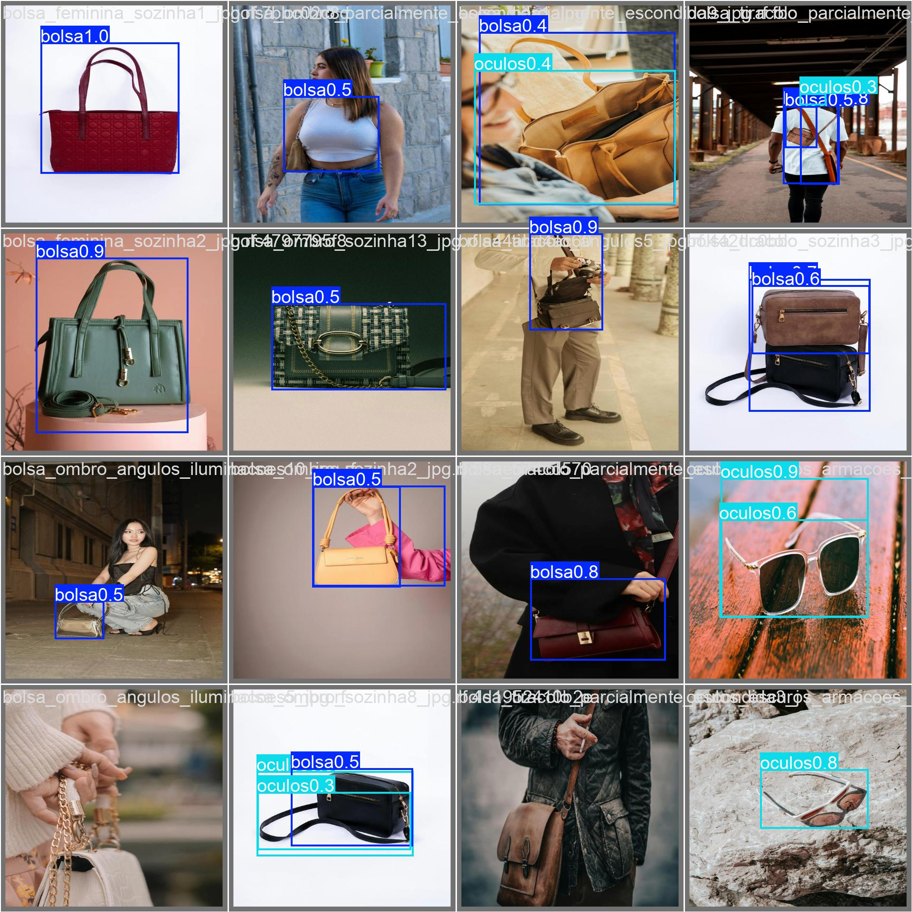

# Detecção de objetos com YOLOv8

Detector de **bolsas, óculos e relógios** em imagens e vídeos, com pesos treinados no arquivo `modelo/best.pt`. A inferência é **100% local**, sem chave de Roboflow, API externa ou acesso ao dataset de treinamento.

## Exemplo visual



*Imagem de predições preservada do experimento anterior. Não é uma nova avaliação de qualidade. Veja [exemplos](docs/EXEMPLOS.md).*

## Execução rápida no Windows (PowerShell)

Com Python **3.12** (ou 3.11) instalado, na pasta do projeto:

```powershell
py -3.12 -m venv .venv
.\.venv\Scripts\python.exe -m pip install -r requirements-inferencia.txt
.\.venv\Scripts\python.exe inferir.py
```

O comando processa as **10 imagens** de `dataset_amostra/test/images`. As imagens anotadas mantêm os nomes de origem e são gravadas em `runs/inferencia_local/`, junto com `deteccoes.csv` e `resumo.json`.

### Testar imagens próprias de uma só vez

Coloque suas imagens em uma pasta separada, por exemplo `Downloads\teste_yolo`:

```powershell
.\.venv\Scripts\python.exe inferir.py --input "$env:USERPROFILE\Downloads\teste_yolo" --output "runs\imagens_proprias"
explorer .\runs\imagens_proprias
```

É possível passar uma única imagem em `--input`. São aceitos JPG, JPEG, PNG, BMP, WEBP e TIFF, **sem percorrer subpastas**. Arquivos originais não são alterados.

### Detectar objetos em um vídeo

O projeto já contém um vídeo original de demonstração:

```powershell
.\.venv\Scripts\python.exe inferir_video.py
explorer .\runs\video_local
```

Para vídeos próprios:

```powershell
.\.venv\Scripts\python.exe inferir_video.py --input "$env:USERPROFILE\Downloads\teste.mp4" --output "runs\video_proprio\anotado.mp4"
```

Aceita entradas MP4, AVI, MOV ou MKV, desde que o OpenCV consiga decodificá-las, e exporta MP4 anotado (dependente do codec disponível). O programa usa as dimensões e o FPS da entrada. Para executar rapidamente apenas parte do vídeo, acrescente `--max-frames 30` (0 = vídeo completo).

### Opções

| Parâmetro | Padrão | Função |
| --- | --- | --- |
| `--input` | Amostra versionada | Arquivo ou pasta de entrada |
| `--model` | `modelo/best.pt` | Checkpoint local |
| `--output` | Diretório em `runs/` | Imagens/pasta ou vídeo MP4 |
| `--conf` | `0.25` | Confiança mínima entre 0 e 1 |
| `--imgsz` | `640` | Tamanho de inferência |
| `--device` | `cpu` | CPU ou GPU CUDA (ex.: `0`) |
| `--max-frames` | `0` | Apenas vídeo; 0 sem limite |

A ajuda está em `python inferir.py --help` ou `python inferir_video.py --help`. Em máquinas com Python 3.11, substitua `py -3.12` por `py -3.11`. Para usar GPU, PyTorch precisa estar instalado com suporte CUDA compatível.

## Relatórios exportados

O CSV contém **uma linha por detecção**, com nome do arquivo, ID e nome da classe, confiança de 0 a 1 e coordenadas `x1, y1, x2, y2` em pixels. Para vídeos, registra também número do quadro e tempo em segundos.

O JSON contém os mesmos registros, parâmetros de inferência e contagens totais. Imagens sem objetos detectados são contabilizadas no resumo; quando não há detecções, o CSV conserva seu cabeçalho. Esses arquivos são salvos junto das imagens ou do vídeo gerado.

**Confiança de detecção não é probabilidade comprovada de acerto, e o número de caixas detectadas não equivale a Precision, Recall ou mAP.** Detalhes em [avaliação e limites](docs/AVALIACAO.md).

## Evidências verificadas e histórico

- [CI anterior, execução #42500205606](https://github.com/FelipeStv0/deteccao-objetos-yolov8/actions/runs/42500205606): checkpoint real executado em CPU, uma imagem processada, uma detecção e imagem anotada com 95.080 bytes.
- Execução **relatada pelo responsável** no Windows com Python 3.12: 10 imagens da amostra processadas com 12 detecções; também relatou funcionamento com 10 imagens adicionais particulares. Os arquivos particulares e rótulos de referência não foram publicados.
- [**CI desta versão, execução #42532214096**](https://github.com/FelipeStv0/deteccao-objetos-yolov8/actions/runs/42532214096): **sucesso**, com **25 testes unitários aprovados em cada uma das quatro combinações** (Windows/Linux, Python 3.11/3.12); checkpoint real em CPU processou **10 imagens, 12 detecções** e **2 quadros de vídeo, 4 detecções**. Os dez arquivos JPG anotados, MP4, CSV e JSON foram validados no CI. O artefato `exemplos-inferencia-yolov8` está disponível nessa execução por 14 dias. Esses totais não medem acurácia.

### Métricas relatadas no relatório original, não reproduzidas independentemente

| Precision | Recall | mAP@0.5 | mAP@0.5:0.95 |
| ---: | ---: | ---: | ---: |
| 0,806 | 0,770 | 0,818 | 0,535 |

Esses números constam no relatório original, na validação identificada como **ONNX, etapa 8**. A inferência local e o CI comprovam o funcionamento do sistema em cenários específicos, **não** a validade das métricas publicadas. A reprodução exige o dataset original anotado e um protocolo de avaliação equivalente.

## Engenharia de ML: auditoria, avaliação e benchmark

A nova trilha transforma a demonstração em um **estudo de caso auditável**, preservando a separação entre resultados experimentais e evidência de generalização.

```powershell
.\.venv\Scripts\python.exe -m pip install -r requirements-avaliacao.txt
.\.venv\Scripts\python.exe auditar_dataset.py
.\.venv\Scripts\python.exe avaliar_modelo.py --device cpu
explorer .\runs\avaliacao_amostra
```

- **Auditoria da amostra:** verifica rótulos, limites das caixas, correspondência com imagens e SHA-256 entre as divisões (não detecta todas as duplicações visuais).
- **Avaliação exploratória:** calcula Precision, Recall e mAP sobre **apenas dez imagens de teste anotadas**, usando o checkpoint real e o Ultralytics. Esse resultado **não substitui** os números do relatório do conjunto integral.
- **Diagnóstico de erros:** `erros.csv` contém falsos positivos/falsos negativos por imagem com limite de IoU de 0,5 e confiança de 0,25.
- **Benchmark:** `benchmark.json` traz média, mediana, p95 e ambiente de medição; não é FPS medido em vídeo.
- **Rastreabilidade:** `metricas_amostra.json` inclui hash SHA-256 do checkpoint, versões e parâmetros.

A documentação inclui [model card](docs/MODEL_CARD.md), [guia completo de reprodução](docs/REPRODUCAO.md) e [estudo de caso para entrevistas](docs/PORTFOLIO.md). O [GitHub Actions de avaliação](https://github.com/FelipeStv0/deteccao-objetos-yolov8/actions/workflows/avaliacao-amostra.yml) publica os relatórios como artefatos de cada execução.

**Limite científico:** não há acesso ao dataset integral nem validação externa independente; nenhuma nota de portfólio ou medição reduzida deve ser confundida com precisão de produção.

## Testes automatizados

```powershell
.\.venv\Scripts\python.exe -m unittest discover -s tests -v
```

Os testes unitários usam objetos YOLO/OpenCV simulados para verificar seleção de arquivos, parâmetros, contagens, exportação CSV/JSON, ausência de detecções e processamento de vídeo. A integração real é um job **separado** no GitHub Actions.

## Estrutura

```text
inferir.py                    # Inferência de imagens
inferir_video.py              # Inferência de vídeo
relatorios.py                 # Exportação CSV/JSON
modelo/best.pt                # Pesos treinados
dataset_amostra/              # Amostra reduzida com imagens e labels
video/                        # Vídeo de entrada e resultado anterior
resultados/                   # Gráficos e imagens originais
tests/                        # Testes unitários
docs/EXEMPLOS.md              # Referências visuais e saídas reprodutíveis
docs/AVALIACAO.md             # Evidências, métricas e limitações
requirements-inferencia.txt   # Dependências para demonstrar localmente
requirements.txt              # Dependências legadas do notebook
notebook.ipynb                # Treinamento/experimento original
```

O experimento original documenta aproximadamente 500 imagens anotadas no padrão YOLO, uso de `yolov8s.pt`, 50 épocas, tamanho 640×640 e Google Colab com Tesla T4.

A reprodução do treinamento integral depende do **dataset original e de permissões adequadas**, não contidos na amostra reduzida. O notebook original depende de credencial autorizada `ROBOFLOW_API_KEY` para acessar o workspace. Os scripts locais de inferência **não usam Roboflow**.

Verifique licença e permissão antes de redistribuir imagens, vídeos, pesos de terceiros ou fotografias com pessoas identificáveis.
