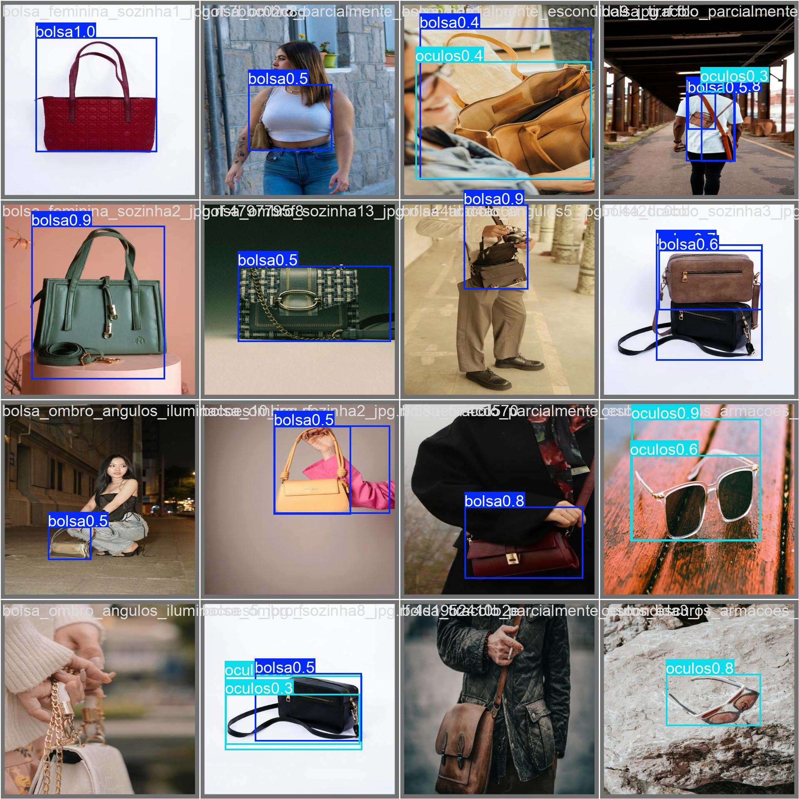

# Object Detection with YOLOv8

**Language:** [English](README_EN.md) | [Português](README.md)

A computer vision project that detects **bags, glasses, and watches** in images and videos. It uses an existing YOLOv8 checkpoint at `modelo/best.pt` and runs **locally**, without a Roboflow key or an external prediction API.

This repository is a learning and portfolio project. It includes inference scripts, a small labeled dataset sample, test results, and automated checks.

## Example output

*This image comes from the original experiment. It is not a new accuracy evaluation.*

## Main features

- Run object detection on one image or all supported images in a folder.
- Process a local video and save a new video with detection boxes.
- Export detection information to CSV and JSON.
- Check image/label files and evaluate the model on a **small labeled sample**.
- Run automated tests on Windows and Linux with Python 3.11 and 3.12.
- Use the included checkpoint on CPU, without downloading the full training dataset.

## Tools and technologies

| Tool | Use |
| --- | --- |
| Python | Inference scripts and automation |
| YOLOv8 / Ultralytics | Object detection |
| PyTorch | Model execution |
| OpenCV | Video reading and writing |
| CSV / JSON | Exporting predictions and summaries |
| GitHub Actions | Automated tests and example runs |

## Quick start — Windows PowerShell

Use Python **3.12 or 3.11**. In the repository folder:

~~~powershell
py -3.12 -m venv .venv
.\.venv\Scripts\python.exe -m pip install -r requirements-inferencia.txt
.\.venv\Scripts\python.exe inferir.py
~~~

By default, the script processes the **10 test images** in `dataset_amostra/test/images`. It saves annotated images, `deteccoes.csv`, and `resumo.json` in `runs/inferencia_local/`.

### Detect objects in your own images

~~~powershell
.\.venv\Scripts\python.exe inferir.py --input "$env:USERPROFILE\Downloads\my_images" --output "runs\my_images"
explorer .\runs\my_images
~~~

`--input` can also point to one image. Supported formats include JPG, JPEG, PNG, BMP, WEBP, and TIFF. Files inside subfolders are not scanned. Source files are not overwritten.

### Detect objects in a video

Run the included example video:

~~~powershell
.\.venv\Scripts\python.exe inferir_video.py
explorer .\runs\video_local
~~~

Or supply your own video:

~~~powershell
.\.venv\Scripts\python.exe inferir_video.py --input "$env:USERPROFILE\Downloads\example.mp4" --output "runs\my_video\annotated.mp4"
~~~

Input formats: MP4, AVI, MOV, and MKV, if supported by the installed OpenCV codecs. Output is an annotated MP4 with the input video's frame size and FPS. Use `--max-frames 30` to process only the first 30 frames.

### Command options

| Option | Default | Meaning |
| --- | --- | --- |
| `--input` | Included sample | Input image, folder, or video |
| `--model` | `modelo/best.pt` | Model checkpoint |
| `--output` | Folder in `runs/` | Output location |
| `--conf` | `0.25` | Minimum detection confidence |
| `--imgsz` | `640` | Model input size |
| `--device` | `cpu` | CPU or CUDA GPU, such as `0` |
| `--max-frames` | `0` | Video only; 0 means no limit |

For more options, use `python inferir.py --help` or `python inferir_video.py --help`. CUDA execution requires a compatible PyTorch installation.

## Exported results

The CSV contains one row for each detected object, with its file name, class, confidence score, and bounding box coordinates (`x1, y1, x2, y2` in pixels). Video detections also include frame number and time.

The JSON file stores these results together with input settings and overall counts. An image with no detections is still counted, and an empty CSV still includes its header.

**A confidence score does not prove that a detection is correct. A count of detections is not the same as Precision, Recall, or mAP.**

## Model evaluation

The repository has two types of results that should **not** be presented as equivalent.

### Results from the original report

The original experiment reported:

| Precision | Recall | mAP@0.5 | mAP@0.5:0.95 |
| ---: | ---: | ---: | ---: |
| 0.806 | 0.770 | 0.818 | 0.535 |

These are **reported historical results**, not independently reproduced by the local inference script. The full original dataset and complete evaluation settings are needed to reproduce them.

### Reproduced results on a small sample

Using the included checkpoint and **10 labeled test images**, an automated CPU run measured:

| Precision | Recall | mAP@0.5 | mAP@0.5:0.95 |
| ---: | ---: | ---: | ---: |
| 0.6948 | 0.7736 | 0.7099 | 0.4210 |

The same sample audit reported:
- 10 training images / 11 labeled boxes;
- 10 validation images / 11 labeled boxes;
- 10 test images / 10 labeled boxes;
- no structural label errors in this small sample;
- 10 matched-operation errors (false positives and false negatives combined);
- average CPU inference time of **236.56 ms per image** in the recorded CI environment.

These measurements are **not evidence of real-world accuracy or performance on other computers**. Inference demonstrations also processed 10 images with 12 detections and two video frames with four detections. Those counts are not accuracy metrics.

See [sample evaluation details](docs/AVALIACAO.md), the [model card](docs/MODEL_CARD.md), and [reproduction instructions](docs/REPRODUCAO.md). The supporting documents are currently in Portuguese.

### Reproduce the sample evaluation

~~~powershell
.\.venv\Scripts\python.exe -m pip install -r requirements-avaliacao.txt
.\.venv\Scripts\python.exe auditar_dataset.py
.\.venv\Scripts\python.exe avaliar_modelo.py --device cpu
explorer .\runs\avaliacao_amostra
~~~

The evaluation exports:
- `metricas_amostra.json`: metrics, checkpoint hash, and settings;
- `erros.csv`: matched false-positive and false-negative cases;
- `comparacoes/`: images with ground-truth and predicted boxes;
- `benchmark.json`: CPU timing details for this specific environment.

The audit checks file pairs, label coordinates, and hashes. It does not identify all possible visual duplicates or dataset issues.

## Automated tests

~~~powershell
.\.venv\Scripts\python.exe -m unittest discover -s tests -v
~~~

Unit tests use simulated YOLO/OpenCV objects, while separate GitHub Actions jobs run the **real checkpoint on CPU**.

[Inference and test workflow](.github/workflows/testes-inferencia.yml) · [Sample evaluation workflow](.github/workflows/avaliacao-amostra.yml)

## Project organization

| File or folder | Purpose |
| --- | --- |
| `inferir.py` | Run detection on local images |
| `entrada_imagens.py` | Find and validate image inputs |
| `inferir_video.py` | Run detection on video frames |
| `validacao.py` | Shared parameter and checkpoint checks |
| `relatorios.py` | Write CSV and JSON results |
| `modelo/best.pt` | Included trained checkpoint |
| `dataset_amostra/` | Small labeled sample for demonstration |
| `avaliar_modelo.py` | Run sample evaluation |
| `auditar_dataset.py` | Check sample image/label integrity |
| `tests/` | Automated tests |
| `docs/` | Detailed reports, model card, and maintenance guidance |

The original notebook documents training using YOLOv8s, image size 640 × 640, and 50 epochs. The full training dataset is **not included**. Re-running complete training requires access to the original data and appropriate permissions. The original notebook also depends on an authorized Roboflow workspace; the local inference scripts do not.

## Responsible use and limitations

This is an **educational, non-commercial portfolio project**. That purpose does **not** automatically give permission to copy or share images, videos, datasets, or other third-party content. Check each file's source, license, attribution rules, and redistribution rights before using it. Personal image rights may also apply.

The included sample is too small for reliable conclusions about generalization, fairness, or production use. Model evaluation should be repeated on a suitable independent dataset before making such claims.

For code changes and future integrations, see the [maintenance guide](docs/GUIA_MANUTENCAO.md) (Portuguese).
