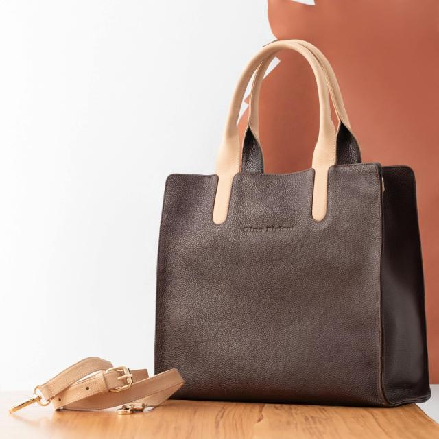
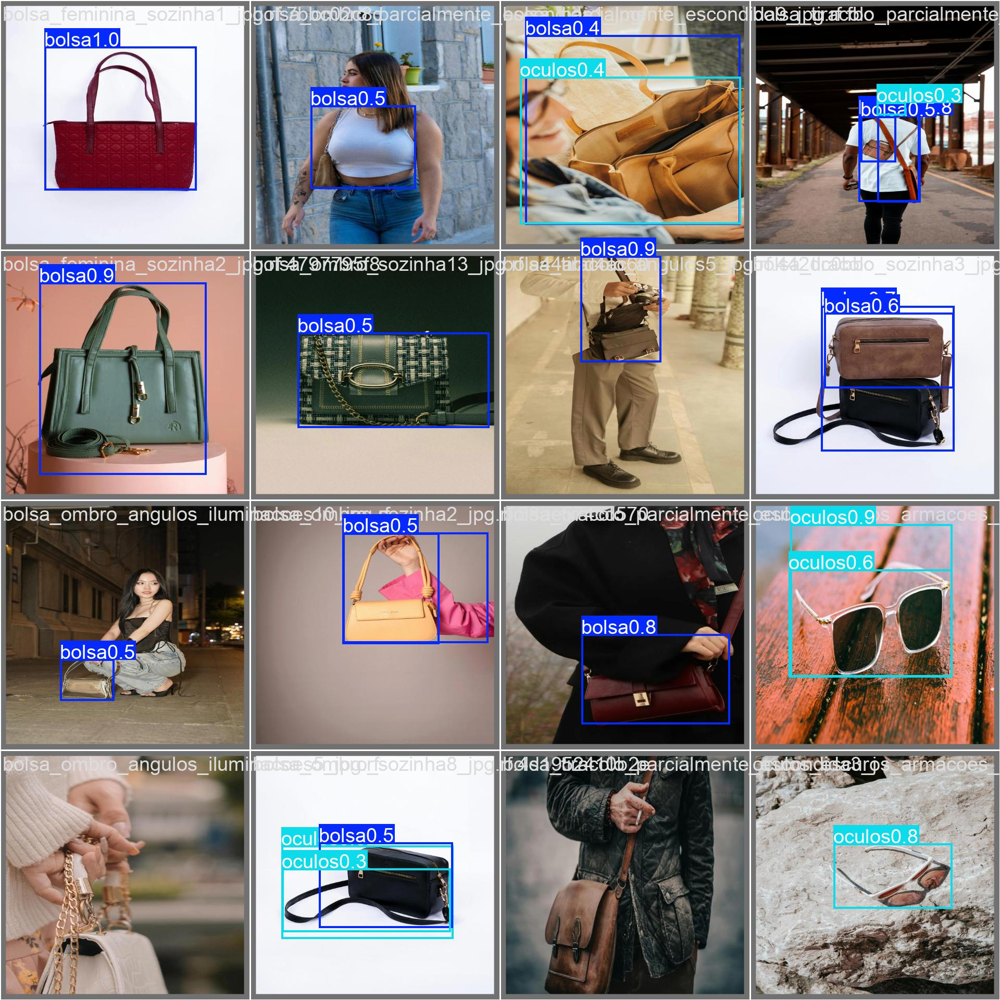

# Demonstrações visuais de inferência

Exemplo de **imagem original** já versionada na amostra reduzida:



**Imagem com predições** preservada do experimento antigo:



**Aviso:** essas duas imagens **não são apresentadas como um par antes/depois**. O artefato da segunda imagem pertence ao experimento original e não demonstra o resultado do novo script.

## Gerar exemplos reproduzíveis

Após instalar os pacotes, execute na raiz do projeto:

```powershell
.\.venv\Scripts\python.exe inferir.py --input "dataset_amostra\test\images" --output "runs\meus_exemplos"
explorer .\runs\meus_exemplos
```

Essa pasta conterá as imagens anotadas e os relatórios `deteccoes.csv` e `resumo.json`. Se não houver detecção numa imagem, ela continuará no resumo com zero ocorrências.

Para visualizar vídeo:

```powershell
.\.venv\Scripts\python.exe inferir_video.py --max-frames 30
explorer .\runs\video_local
```

## Exemplos do GitHub Actions

O [workflow de inferência](https://github.com/FelipeStv0/deteccao-objetos-yolov8/actions/workflows/testes-inferencia.yml) utiliza o checkpoint real sobre as **10 imagens de teste do próprio repositório** e **2 quadros do vídeo original**. Na [execução #42532214096](https://github.com/FelipeStv0/deteccao-objetos-yolov8/actions/runs/42532214096), os cinco jobs passaram: foram confirmadas **10 imagens anotadas, 12 detecções** e um **MP4 com 2 quadros processados e 4 detecções**, além de CSV/JSON consistentes. Nessa execução, é possível baixar o artefato **exemplos-inferencia-yolov8** (retenção de 14 dias), contendo imagens anotadas, trecho do vídeo e relatórios. O download requer acesso ao GitHub; esse resultado é uma verificação funcional, não uma medição de acurácia.

As **10 fotos particulares adicionais** foram testadas pelo responsável, que relatou funcionamento, mas elas não estão acessíveis nem foram incorporadas ao GitHub. Não publicamos imagens particulares, nem atribuímos uma taxa de acerto sem anotações independentes.

Antes de adicionar novos arquivos, confira direitos de uso e autorização de eventuais pessoas fotografadas.
